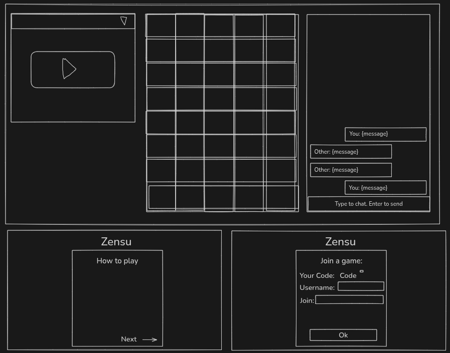

# zensu

> **Work in progress:** the game is playable but not finished. Expect missing features, rough edges and breaking changes.

**Play:** https://benlgw.github.io/zensu/

## Development

Built with Svelte 5, TypeScript and Vite, and uses [PeerJS](https://peerjs.com/) for multiplayer.

## Wireframe

Below is a wireframe showing the design I intended before starting.  

## AI disclaimer

Parts of this project were made with help from an AI assistant (Claude), including tests, config files, github actions, and this README.

## License

[GPL-3.0](LICENSE)
